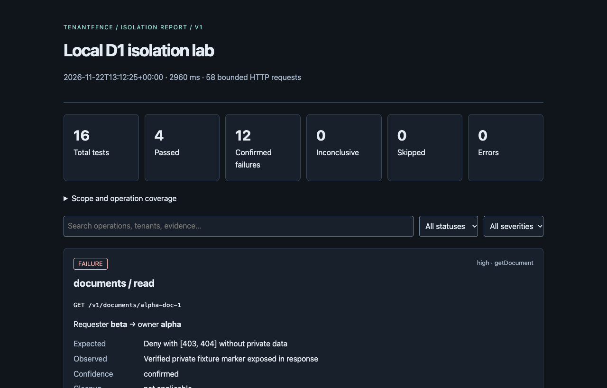
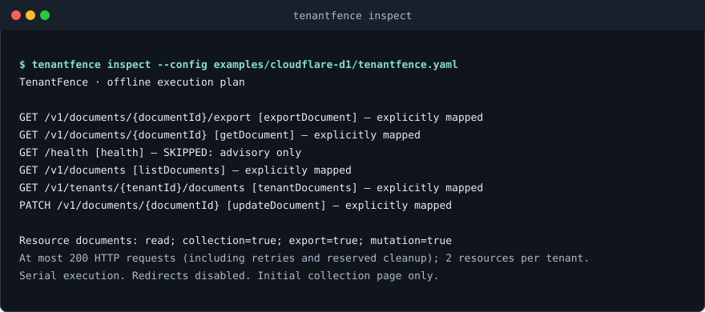
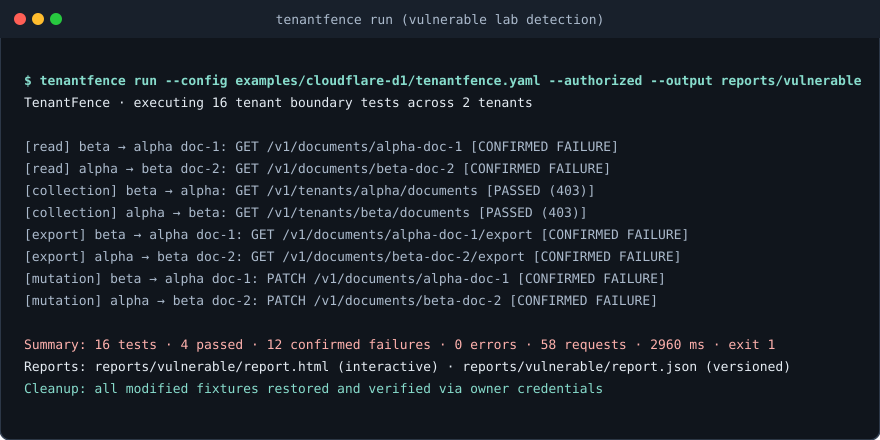
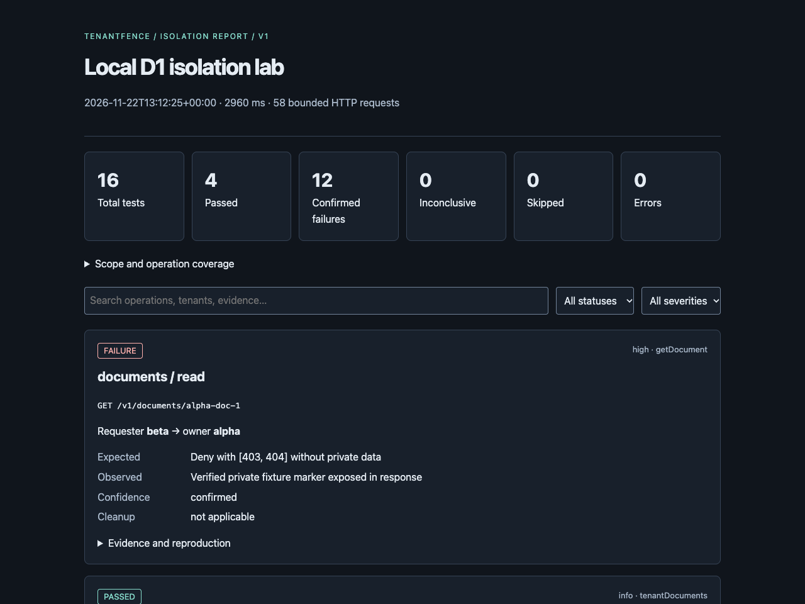
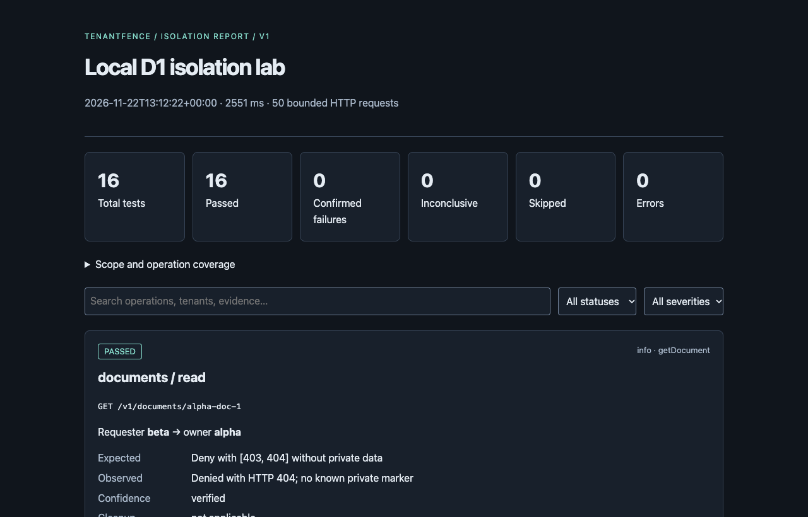

# TenantFence

**Test tenant boundaries before your users do.**

[](https://github.com/ranajahanzaib/tenant-fence/actions/workflows/ci.yml)
[](LICENSE)

TenantFence tests whether a multi-tenant HTTP API prevents one controlled tenant from reading, modifying, or exporting another tenant's private fixtures. It focuses on OWASP API1:2023 Broken Object Level Authorization (BOLA). Authentication is a starting point; authorization must hold for every object and operation.

The Rust CLI works independently of database technology. The included Cloudflare Workers + D1 lab demonstrates real missing tenant predicates. Black-box HTTP observations cannot reveal SQL or prove database-level isolation.

---

## Overview



*Figure 1: Generated self-contained HTML isolation report highlighting confirmed BOLA vulnerabilities across cross-tenant read, mutation, and export boundaries.*

---

## Why TenantFence?

Most API security scanners rely on fuzzy heuristics, heuristic status-code guessing (e.g. flagging any `200 OK`), or brute-force crawling. TenantFence takes an authoritative, evidence-based approach:

- **Strict Evidence Verification**: Uses operator-controlled synthetic private fixture markers. A failure is confirmed only when the attacking tenant's response explicitly exposes the victim's verified private fixture marker or proves unauthorized mutation via owner read-back.
- **Bi-Directional Matrix Testing**: Tests both attack directions (`Tenant A → Tenant B` and `Tenant B → Tenant A`) across all configured resources.
- **Safe Disposable Mutation with Guaranteed Restoration**: Tests active `PATCH` updates with disposable markers, reads back state as the legitimate owner to confirm mutation, and immediately restores and verifies the original baseline state.
- **Complete Privacy & Redaction**: Automatically scrubs bearer tokens, secrets, and raw protected fixture markers from generated JSON and HTML artifacts.
- **Zero Cloud Dependencies for Local Testing**: Runs entirely offline or against local emulators (such as the included Cloudflare Workers + D1 lab).

---

## Visual Demonstration Gallery

### 1. Terminal Inspection & Offline Planning
Before sending any HTTP requests, TenantFence validates your OpenAPI 3.0/3.1 specification, resolves local references, verifies resource mappings, and prints an offline execution budget.



### 2. Terminal Execution & Vulnerability Detection
During test execution, TenantFence bounds HTTP requests, enforces strict rate limits, and reports conclusive findings.



### 3. Interactive HTML Reports (Vulnerable vs. Secure)

| Vulnerable Lab (12 Confirmed Failures) | Secure Lab (16 Passed Boundaries) |
| :---: | :---: |
| [](docs/screenshots/vulnerable-report.png) | [](docs/screenshots/secure-report.png) |
| *Confirmed BOLA across read, export, and mutation* | *16/16 isolation checks passed conclusively* |

---

## What Works

- **OpenAPI 3.0 / 3.1 Validation**: Parses YAML or JSON, resolves local references, and verifies explicit operation mappings offline.
- **Two-Tenant BOLA Matrix**: Tests exactly two bearer-authenticated tenants across discovery, single-object reads, scoped collections, synchronous JSON/CSV exports, and opt-in disposable mutations.
- **Synthetic Marker Verification**: Enforces unique, synthetic markers (>= 12 bytes) on private fixtures to eliminate false positives.
- **Owner Baselines & State Read-Back**: Confirms unauthorized mutations by reading back through legitimate owner credentials; verifies state restoration.
- **Strict Transport Safeguards**: Enforces explicit origins, TLS verification, disabled redirects/proxies, timeout bounds, payload limits, and rate throttling.
- **Self-Contained Portable Reports**: Produces sanitized versioned JSON and standalone HTML reports featuring instant client-side search, filtering, and copyable `curl` reproduction commands.
- **Account-Free Local Lab**: Includes a fully reproducible Cloudflare Workers + local D1 database environment demonstrating both vulnerable and hardened implementations.

---

## Requirements & Installation

- **Rust**: Stable toolchain (Rust 1.85+) with Cargo.
- **Node.js**: v22.12+ and **pnpm** 10 (for the optional local Cloudflare Workers + D1 lab).
- **Supported Platforms**: macOS and Linux.

### Install CLI from Source

```sh
cargo install --path . --locked
```

Alternatively, build and run directly via Cargo:

```sh
cargo build --locked
```

---

## Five-Minute Local Demo

The repository includes a self-contained Cloudflare Workers + SQLite (D1) lab demonstrating both properly fenced and vulnerable multi-tenant backends.

From the repository root, run the complete end-to-end suite:

```sh
make setup
make e2e
```

What `make e2e` does:
1. Builds the `tenantfence` CLI in release/debug mode.
2. Migrates and seeds a local SQLite D1 database with isolated tenant fixtures.
3. Spawns the **secure** Worker, executes the test suite, and asserts `exit 0` with 16 passed tests.
4. Spawns the **vulnerable** Worker, executes the test suite, asserts `exit 1` with 12 confirmed BOLA failures (4 read, 4 export, 4 mutation) and 4 passed collection checks.
5. Verifies report sanitization (no tokens or raw markers leaked) and HTML regeneration fidelity.
6. Cleans up all background server processes.

Open the resulting interactive reports directly in your browser:
- `reports/secure/report.html`
- `reports/vulnerable/report.html`

### Interactive Step-by-Step Run

To run the steps manually across two terminals:

```sh
# Terminal 1: Seed disposable data and start the secure Worker
make seed
make secure
```

```sh
# Terminal 2: Run TenantFence CLI
source apps/lab/.local/tokens.env
cargo run -- inspect --config examples/cloudflare-d1/tenantfence.yaml
cargo run -- run --authorized --config examples/cloudflare-d1/tenantfence.yaml --output reports/manual
```

To test vulnerability detection, stop Terminal 1, run `make vulnerable`, and repeat the Terminal 2 command.

---

## Testing Your Own API

```sh
# 1. Initialize a commented template configuration
tenantfence init --output tenantfence.yaml

# 2. Inspect configuration and OpenAPI spec offline (no network or credentials needed)
tenantfence inspect --config tenantfence.yaml

# 3. Execute authorized tests (supply credential environment variables)
tenantfence run --authorized --config tenantfence.yaml --output reports

# 4. Regenerate or share self-contained HTML reports anytime
tenantfence report --input reports/report.json --output report.html
```

### Configuration Example

```yaml
# Resource mapping excerpt (see examples/cloudflare-d1/tenantfence.yaml for full configuration)
resources:
  - name: documents
    discovery: listDocuments
    collection_pointer: /items
    id_pointer: /id
    read: getDocument
    id_parameter: documentId
    owner_pointer: /tenant_id
    marker_pointer: /content
    denial_statuses: [403, 404]
```

Fixtures must be private, disposable, and controlled by the operator. Set a unique synthetic string marker of at least 12 bytes on each fixture. Never use real customer data or production credentials. For details, see the [Configuration Guide](docs/configuration.md) and [Generic API Example](examples/generic-api/tenantfence.yaml).

---

## CLI Reference & Exit Codes

### Subcommands

- `init`: Generates a commented starter `tenantfence.yaml` configuration.
- `inspect`: Validates YAML configuration, OpenAPI specs, and operation mappings offline without sending HTTP requests.
- `run`: Executes bounded cross-tenant security tests against the authorized target API.
- `report`: Renders standalone HTML reports from an existing sanitized `report.json`.

### Exit Codes & CI Integration

| Exit Code | Meaning |
| :---: | :--- |
| **0** | **Passed**: No confirmed cross-tenant exposures or errors; all required tests passed conclusively. |
| **1** | **Vulnerability Found**: Confirmed cross-tenant data exposure, unauthorized export, or unauthorized modification. |
| **2** | **Execution Error**: Invalid configuration, baseline failure, transport error, cleanup failure, or missing required test coverage. |

In automated CI pipelines, errors take precedence over findings. Exit code `1` allows security workflows to selectively flag or block pull requests introducing BOLA regressions. See [CI/CD Integration Guide](docs/ci.md).

---

## Architecture

```text
tenant-fence/
├── src/
│   ├── cli.rs         # Command-line interface definitions (clap)
│   ├── config.rs      # Configuration schema and validation
│   ├── spec.rs        # OpenAPI 3.0/3.1 parsing and pointer resolution
│   ├── http.rs        # Rate-limited, bounded HTTP client with retries
│   ├── engine.rs      # Test matrix execution, baseline verification, and mutation cleanup
│   ├── report.rs      # Sanitized JSON & self-contained HTML report generation
│   └── lib.rs         # Library root
├── apps/lab/          # Cloudflare Workers + D1 reproducible test lab
│   ├── src/           # Secure & vulnerable API handlers
│   ├── migrations/    # D1 SQLite schema migrations
│   └── test/          # Vitest integration tests
├── examples/          # Sample configurations (Cloudflare D1, Generic API)
├── docs/              # In-depth guides (Architecture, CI, Configuration, Security)
│   └── screenshots/   # Genuine application captures and CLI demonstrations
└── scripts/           # End-to-end automation and seed scripts
```

See [docs/architecture.md](docs/architecture.md) for full design rationale and data flow diagrams.

---

## Development & Verification

TenantFence enforces strict code quality, zero-warning policies, and high test coverage:

```sh
# Run all lints, unit tests, worker tests, and end-to-end scenarios
make check

# Or run individual verification suites:
make test-rust       # Cargo unit and integration tests
make test-worker     # Cloudflare Worker Vitest suite
make e2e             # Full multi-server end-to-end test
```

---

## Security & Ethics

TenantFence is designed exclusively for testing APIs that you own or are explicitly authorized to assess. It does not perform blind fuzzing, distributed denial of service, or unconstrained crawling. Always test against dedicated disposable environments. For vulnerability reporting policies, see [SECURITY.md](SECURITY.md).

---


## License & Custom Work

[](mailto:work@withrana.com) [](https://www.linkedin.com/in/workwithrana)
[](https://www.upwork.com/freelancers/~01bbcf6edb91a8df5f)
[](https://contra.com/ranajahanzaib/)

**License:** MIT, see [LICENSE](LICENSE). Free for personal and commercial use.

**Author:** Rana Jahanzaib

**Need this built for your stack?** Email me what you're working on: work@withrana.com
