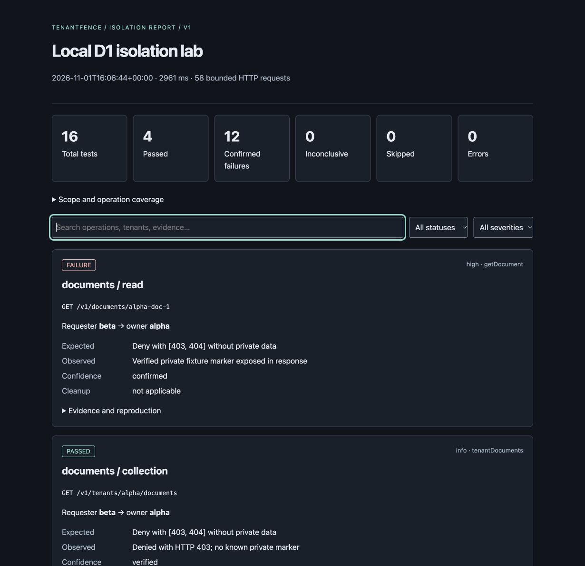

# TenantFence

**Test tenant boundaries before your users do.**

TenantFence tests whether a multi-tenant HTTP API prevents one controlled tenant from reading, modifying, or exporting another tenant's private fixtures. It focuses on OWASP API1:2023 Broken Object Level Authorization (BOLA). Authentication is a starting point; authorization must hold for every object and operation.

The Rust CLI works independently of database technology. The included Cloudflare Workers + D1 lab demonstrates real missing tenant predicates. Black-box HTTP observations cannot reveal SQL or prove database-level isolation.

## What works

- OpenAPI 3.0/3.1 YAML or JSON, local references, explicit operation mappings and an offline plan.
- Exactly two bearer-authenticated tenants, discovery or supplied fixture IDs, both attack directions.
- Owner baselines with verified IDs, ownership and unique synthetic markers.
- Read, scoped collection, synchronous JSON/CSV export, and opt-in disposable PATCH tests.
- Owner read-back confirms unauthorized changes; authorized restoration is verified.
- Explicit origins, TLS verification, disabled redirects/proxies, bounded time, body size, rate and total requests.
- Versioned sanitized JSON and self-contained HTML with filters, search and reproduction commands.
- Rust mock-server tests, real Worker/D1 tests, and an account-free local end-to-end demonstration.

## Install

Requirements: stable Rust with Cargo, Node.js **22.12+**, pnpm 10, macOS or Linux. No Docker or Cloudflare account is needed for local testing.

```sh
cargo install --path . --locked
pnpm install --dir apps/lab --frozen-lockfile
```

The CLI is built from source; this project does not claim a published crates.io release.

## Five-minute local demo

From the repository root, run the complete reproducible demonstration:

```sh
make setup
make e2e
```

This builds the CLI, migrates and resets local D1, generates random local credentials, starts each Worker in turn, checks actual protected data and restored state, and shuts down the servers. Port 8787 must be free. The secure run must exit 0 with 16 passing tests. The vulnerable run must exit 1 with 12 confirmed failures (four each for read, modification and export) and four passing collection checks. The script intentionally asserts that failure rather than treating it as a CI failure.



Open `reports/secure/report.html` and `reports/vulnerable/report.html` locally. Reports need no server or external assets. `make e2e` also verifies JSON-to-HTML regeneration and absence of credentials/raw fixture content.

For an interactive run, use two terminals:

```sh
# Terminal 1: seed disposable data and start secure Worker
make seed
make secure
```

```sh
# Terminal 2
source apps/lab/.local/tokens.env
cargo run -- inspect --config examples/cloudflare-d1/tenantfence.yaml
cargo run -- run --authorized --config examples/cloudflare-d1/tenantfence.yaml --output reports/manual
```

Stop the secure Worker, then `make vulnerable` in terminal 1 and rerun the CLI. This local-only launcher binds loopback. The deployable secure entrypoint never imports the vulnerable handlers. Do not expose the lab through a tunnel, proxy or public binding. `make seed` resets titles, documents and credentials; source the new environment afterward.

## Your API

```sh
tenantfence init --output tenantfence.yaml
# Edit spec path, target origin, tenant selectors and explicit resource mappings.
tenantfence inspect --config tenantfence.yaml
# Supply the named credential environment variables through your secret manager.
tenantfence run --authorized --config tenantfence.yaml --output reports
tenantfence report --input reports/report.json --output report.html
```

`init` disables active writes by default and refuses to overwrite unless `--force` is supplied. Paths to specifications are relative to the configuration file. `inspect` makes no HTTP requests and does not require credentials.

```yaml
# Resource mapping excerpt; see the complete examples for target/tenants/execution.
resources:
  - name: documents
    discovery: listDocuments
    collection_pointer: /items
    id_pointer: /id
    read: getDocument
    id_parameter: documentId
    owner_pointer: /tenant_id
    marker_pointer: /content
    denial_statuses: [403, 404]
```

Fixtures must be private, disposable and controlled by the operator. Set a unique synthetic string marker of at least 12 bytes on each fixture. Supply the real tenant selector used by the ownership field. Never use production customer data as markers. See [configuration](docs/configuration.md) and the [generic read-only example](examples/generic-api/tenantfence.yaml).

## Results and CI

| Exit | Meaning                                                                                           |
| ---- | ------------------------------------------------------------------------------------------------- |
| 0    | No confirmed failures or errors; every required test completed conclusively                       |
| 1    | Confirmed cross-tenant exposure or modification                                                   |
| 2    | Invalid input, baseline/runtime error, cleanup failure, or required inconclusive/skipped coverage |

Errors take precedence over confirmed findings. Optional inconclusive/skipped tests do not force exit 2 and remain visible in reports. Explicitly require categories that gate deployment. A successful HTTP response alone never confirms a vulnerability.

The [CI workflow](.github/workflows/ci.yml) runs formatting, warning-denied Clippy, Rust tests, TypeScript checks, Worker tests and both actual local D1 scenarios, then uploads sanitized reports. No repository secrets or paid services are required. [CI details](docs/ci.md).

## Architecture and limits

`src/` contains configuration validation, OpenAPI normalization, bounded HTTP execution, fixture/evidence evaluation and report rendering. `apps/lab/` contains secure routes, separate local vulnerable handlers, migrations, seed scripts and Worker tests. `examples/`, `tests/`, `scripts/` and `docs/` hold reproducible integrations and guidance.

The MVP runs serially, inspects the configured initial collection page, supports bearer tokens and synchronous exports, and resolves only local non-cyclic references. It requires JSON owner detail baselines. It does not perform schema-complete OpenAPI validation, infer public/private data, inspect D1 queries, brute-force IDs, follow redirects, run destructive DELETEs, or handle async exports. Marker matching detects exact decoded JSON strings or CSV cells; transformed, binary or compressed application-level exports need explicit future support. A pass applies only to tested fixtures, operations and policies.

Interrupted processes cannot guarantee cleanup. Use isolated disposable data and reset the lab after interruption. See [security](docs/security.md), [findings](docs/findings.md), [architecture](docs/architecture.md) and [report schema](docs/report-schema.md).

## Development and roadmap

`make check` runs all checks including end-to-end tests. `make test-rust`, `make test-worker`, `make reports`, `make seed`, `make secure` and `make vulnerable` are available separately. See [CONTRIBUTING.md](CONTRIBUTING.md).

Next improvements: bounded pagination mappings, additional authentication strategies, richer configurable evidence assertions, and portable release binaries. No hosted scanner is planned for this MVP.

## License

MIT.
